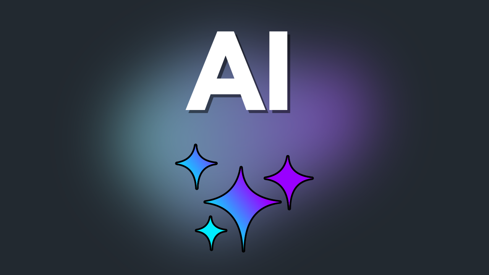
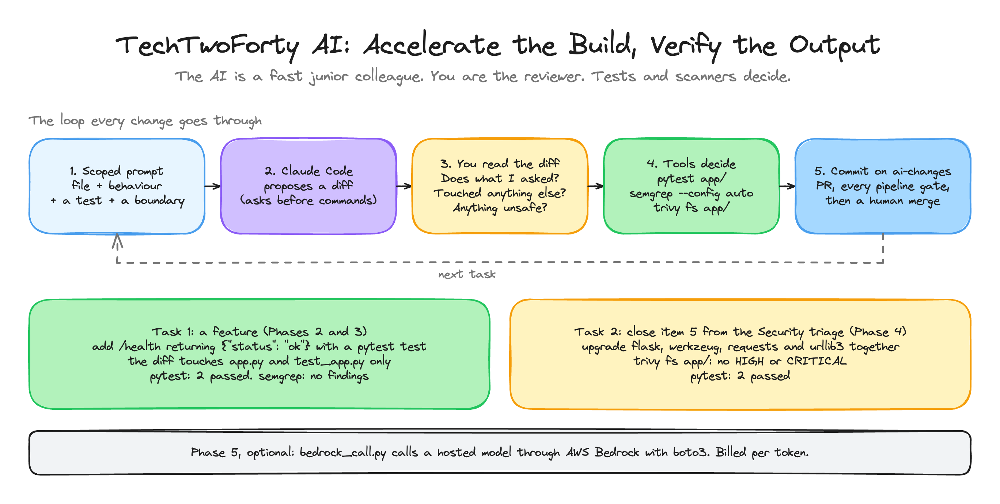

<p align="center">
  
</p>

<h1 align="center">TechTwoForty: AI</h1>
<p align="center"><b>Accelerate the Build, Verify the Output</b> · the finished project</p>
<p align="center">
  <a href="https://github.com/wjpearce-github/TechTwoForty-Security">← Previous: Security</a> ·
  <a href="https://github.com/wjpearce-github/TechTwoForty-Start-Here">Course map</a> ·
  <a href="https://github.com/wjpearce-github/TechTwoForty-Capstone">Next: Capstone →</a>
</p>

> [!TIP]
> **This repo is the finished template for the AI project. Treat it as your cheat sheet.**
> It is your `devsecops-capstone` repo after the `ai-changes` pull request is merged: the `/health` endpoint with its test, and the dependency upgrade that closes item 5 from the Security triage. Your exact version numbers may differ from these. What matters is that `trivy` is clean and `pytest` says **2 passed**.

| | |
|---|---|
| **Section** | 9 of 10 · AI tooling |
| **Time** | About 45 minutes, 5 phases |
| **Runs on** | Claude Code (or an agentic IDE) in your capstone repo. Optional: AWS Bedrock |
| **Deliverable** | Two real changes made with AI help, both read by you and verified by tests and scanners before they were accepted |

## The big picture



<sub>Drawn in Excalidraw. To edit it, open <code>assets/diagram.excalidraw</code> at <a href="https://excalidraw.com">excalidraw.com</a>.</sub>

> [!IMPORTANT]
> **The one rule of the section: never accept a diff you have not read.** Verify with tools, not with how confident the output sounds. And never put a secret in a prompt.

## What changed since the Security project

| File | Change |
|---|---|
| `app/app.py` | New `/health` route returning `{"status": "ok"}`, in the style of the existing route |
| `app/test_app.py` | New `test_health`. `pytest` now says **2 passed** |
| `app/requirements.txt` | `flask`, `werkzeug`, `requests` and `urllib3` upgraded to current versions that work together, plus `pytest` |
| `extras/bedrock_call.py` | Phase 5, optional: one call to a hosted model through Bedrock |

Everything else (pipeline, risk register, `gates.md`, `tools/`, `infra/`) is unchanged from the [Security template](https://github.com/wjpearce-github/TechTwoForty-Security).

## Cheat sheet, phase by phase

### Phase 1 · Point the agent at the repo

```bash
cd ~/devsecops-capstone && git switch -c ai-changes && claude
```

On a branch, never on main. Claude Code asks before every command it runs. That approval is the safety model.

### Phase 2 · A well-scoped task
The prompt, word for word:

```text
In app/app.py, add a /health endpoint that returns {"status": "ok"} as JSON with a 200 code. Add a pytest test for it in app/. Follow the style of the existing endpoint. Don't change anything else.
```

A named file, an exact behaviour, a required test, a style to match and a boundary. Compare it with "add a health check", which might touch the Dockerfile, rename things or add a dependency.

### Phase 3 · Review, then verify
Read the diff with three questions: **does it do what I asked? did it touch anything else? is anything unsafe?** Then let the tools decide:

```bash
pytest app/                    # 2 passed
semgrep --config auto app/     # no findings
git add -A && git commit -m "Add /health endpoint with test"
```

### Phase 4 · Close the scheduled finding (item 5)

```bash
git checkout vulnerable -- app/requirements.txt && trivy fs --scanners vuln --severity HIGH,CRITICAL app/
```

Only `requirements.txt` comes across from the vulnerable branch. This repo has the [`vulnerable`](https://github.com/wjpearce-github/TechTwoForty-AI/commits/vulnerable) branch too, exactly as the Security project left it, so the command works here as well. Then the prompt:

```text
trivy flags app/requirements.txt for vulnerable flask, werkzeug, requests and urllib3 versions. Upgrade all four to current stable versions that work together, keep pytest, run the tests, and show me the diff. Don't change anything else.
```

```bash
trivy fs --scanners vuln --severity HIGH,CRITICAL app/ && pytest app/    # clean, 2 passed
git add -A && git commit -m "Upgrade the vulnerable dependencies to patched versions" && git push -u origin ai-changes
```

Open a PR and watch every gate from the Security section run against the AI's work. Tests, scans, then a human merge.

### Phase 5 · Optional: call a hosted model

```bash
python3 extras/bedrock_call.py
```

Bedrock bills per token, and model access has to be switched on in the console first. Credentials come from your IAM profile, never from the code. In the walkthrough this file sits wherever you created it. It is in `extras/` here to keep it apart from the app.

## Final handover check

- [ ] Two changes made with AI help, both read and verified before accepting
- [ ] The `/health` endpoint has a passing test
- [ ] The dependency finding from the Security project is closed and `trivy` is clean
- [ ] Nothing was merged without the pipeline running

## Common mistakes

| Mistake | What happens | The fix |
|---|---|---|
| Running Claude Code on `main` | Changes land where branch protection cannot review them | `git switch -c ai-changes` first |
| A vague prompt | A diff that touches files you did not ask about | Name the file, the behaviour, the test and the boundary |
| Approving a diff unread | AI bugs ship with total confidence | Read every line, then run the tools |
| Pasting a key or password into a prompt | The secret leaves your machine | Never. No exceptions |
| `git checkout vulnerable -- .` instead of the one file | Every planted weakness comes back | Only `app/requirements.txt` |

## What you can now do

- **Directing an agent:** scoped tasks with a named file, exact behaviour, a test and a boundary
- **Reviewing AI output:** read every diff, then let tests and scanners decide
- **Closing a backlog:** taking a deferred security finding through to verified fixed
- **Hosted models:** calling a model from your own code with boto3

---

<p align="center">
  <b>TechTwoForty</b> · AI · 9 of 10<br>
  <a href="https://github.com/wjpearce-github/TechTwoForty-Security">← Previous: Security</a> ·
  <a href="https://github.com/wjpearce-github/TechTwoForty-Start-Here">Course map</a> ·
  <a href="https://github.com/wjpearce-github/TechTwoForty-Capstone">Next: Capstone →</a>
</p>
